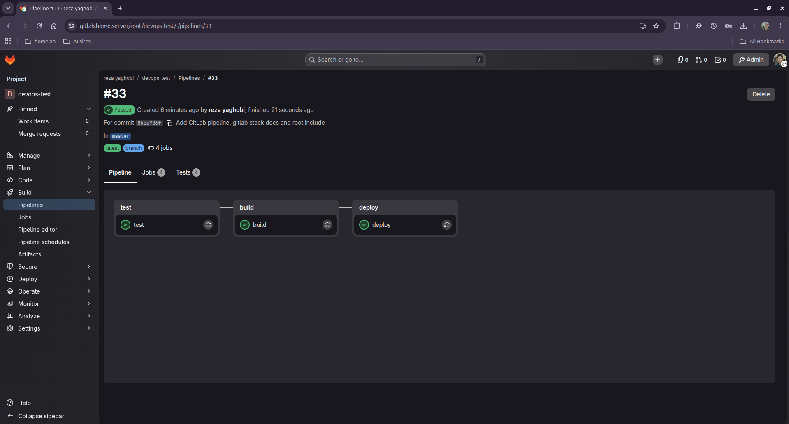
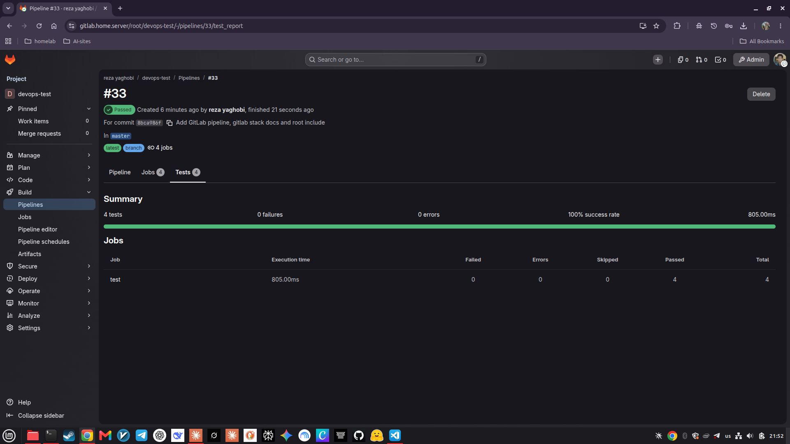

# GitLab CI/CD pipeline

[← Back to the main README](../README.md)

This document explains the automation around the code: where the repository lives, how the pipeline is defined, what each stage does, how the runner is set up, and how to fix the usual problems.

> **In plain words:** every time code is pushed, GitLab starts a robot (the *runner*) that tests the code, builds the Docker image and starts the new version on the server, and fails loudly if anything is wrong. Nobody has to remember to do those steps by hand.

**Contents**

1. [The environment](#1-the-environment)
2. [How one pipeline run flows](#2-how-one-pipeline-run-flows)
3. [The pipeline file](#3-the-pipeline-file)
4. [Stage by stage](#4-stage-by-stage)
5. [Results](#5-results)
6. [Trigger the pipeline](#6-trigger-the-pipeline)
7. [The runner](#7-the-runner)
8. [Failure recovery](#8-failure-recovery)
9. [Security notes and improvements](#9-security-notes-and-improvements)

---

## 1. The environment

| Piece | Details |
|---|---|
| GitLab | Self-hosted GitLab CE, reached at `https://gitlab.home.server`, running in Docker behind a Traefik reverse proxy (TLS) |
| Project | `root/devops-test`, branch `master` |
| Container registry | Available at `registry.home.server` (not used by the pipeline, see the `publish` stage) |
| Runner | `gitlab-runner` container with the **Docker executor**, on the same Docker network as GitLab (`web_net`) |
| Deploy target | The same server: the pipeline starts the webapp on the server's Docker |

The `gitlab/` folder of this repository contains the pipeline file, a copy of the Compose file of the GitLab stack (`compose.yml`, with no secrets) and a short README on registering a runner.

## 2. How one pipeline run flows

```
 git push                                 GitLab (gitlab.home.server)
 ---------> repository  --------------->  creates a pipeline from .gitlab-ci.yml
                                                      |
                                                      v
                                          runner picks up the jobs, one by one
                                                      |
        +---------------------+----------------------+----------------------+
        v                     v                      v                      v
   [ test ]  ------->  [ build ]  ------->  [ publish ]  ------->  [ deploy ]
 pytest in a clean     docker build,        optional,               docker compose up,
 Python container      tag with commit      off by default          wait until healthy
```

Each job runs inside a fresh, disposable container, so a run never depends on leftovers from a previous one. If a stage fails, the next stages do not run.

## 3. The pipeline file

GitLab only reads `.gitlab-ci.yml` from the repository root. To keep CI files in the `gitlab/` folder, the root file just includes the real one:

```yaml
# .gitlab-ci.yml (repository root)
include:
  - local: gitlab/.gitlab-ci.yml
```

The real pipeline, `gitlab/.gitlab-ci.yml`:

```yaml
stages:
  - test
  - build
  - publish
  - deploy

variables:
  GIT_DEPTH: "20"
  PIP_CACHE_DIR: "$CI_PROJECT_DIR/.cache/pip"

# ---------- 1. TEST ----------
test:
  stage: test
  image: python:3.12-slim
  cache:
    key: pip-cache
    paths:
      - .cache/pip
  script:
    - cd webapp
    - pip install -r requirements-dev.txt
    - pytest -v --junitxml=report.xml
  artifacts:
    when: always
    reports:
      junit: webapp/report.xml

# ---------- 2. BUILD ----------
build:
  stage: build
  script:
    - docker build -t webapp:latest -t webapp:$CI_COMMIT_SHORT_SHA webapp
    - docker image ls webapp

# ---------- 3. PUBLISH (opt-in: set CI/CD variable PUSH_TO_REGISTRY=true) ----------
publish:
  stage: publish
  rules:
    - if: '$PUSH_TO_REGISTRY == "true"'
  script:
    - echo "$CI_REGISTRY_PASSWORD" | docker login -u "$CI_REGISTRY_USER" --password-stdin "$CI_REGISTRY"
    - docker tag webapp:$CI_COMMIT_SHORT_SHA $CI_REGISTRY_IMAGE/webapp:$CI_COMMIT_SHORT_SHA
    - docker tag webapp:$CI_COMMIT_SHORT_SHA $CI_REGISTRY_IMAGE/webapp:latest
    - docker push $CI_REGISTRY_IMAGE/webapp:$CI_COMMIT_SHORT_SHA
    - docker push $CI_REGISTRY_IMAGE/webapp:latest

# ---------- 4. DEPLOY (default branch only) ----------
deploy:
  stage: deploy
  rules:
    - if: '$CI_COMMIT_BRANCH == $CI_DEFAULT_BRANCH'
  script:
    - docker network inspect monitoring-net >/dev/null 2>&1 || docker network create monitoring-net
    - docker compose -f webapp/compose.yml up -d --no-build
    - |
      for i in $(seq 1 12); do
        status=$(docker inspect -f '{{.State.Health.Status}}' webapp)
        echo "health: $status"
        [ "$status" = "healthy" ] && exit 0
        sleep 5
      done
      docker logs webapp --tail 50
      exit 1
  environment:
    name: production
```

## 4. Stage by stage

### `test`

- Runs in the image `python:3.12-slim`, a clean Python environment.
- Installs the test dependencies and runs `pytest`. The pip download cache is kept between runs to save time.
- Writes a JUnit XML report. GitLab reads it and shows every test in the pipeline's **Tests** tab.
- `artifacts: when: always` keeps the report even if a test fails, which is exactly when it is needed.

### `build`

- Builds the Docker image from `webapp/Dockerfile`.
- Tags it twice: `webapp:latest` (the newest) and `webapp:<commit id>` (for example `webapp:8bca986f`), so every image can be traced back to the exact code that made it.
- The runner talks to the server's Docker through the mounted Docker socket (see [section 7](#7-the-runner)), so the image ends up on the same Docker that the deploy stage uses. That is why `deploy` does not need to rebuild.

### `publish` (optional)

Pushes the image to the project's container registry. It only runs when the CI/CD variable `PUSH_TO_REGISTRY` is set to `true` (**Settings → CI/CD → Variables**). It is switched off because the task does not need a registry and the server's Docker would first have to trust the registry's certificate. This is why the pipeline graph below shows three stages, not four.

### `deploy`

- Runs only on the default branch, so work on other branches is tested and built but never deployed.
- Makes sure the shared network `monitoring-net` exists.
- Starts the service with `docker compose up -d --no-build`, using the image the previous stage built.
- **Verifies the result:** it asks Docker for the container's health status every 5 seconds, up to 12 times (one minute). If the container becomes `healthy`, the job succeeds. If not, the job prints the container logs and fails. A deploy that "ran the command" but left a broken service therefore turns the pipeline red.

## 5. Results



*Pipeline #33 for commit `8bca986f` on `master`: the three stages **test**, **build** and **deploy** passed in sequence. The optional `publish` stage does not appear because its rule did not match.*



*The **Tests** tab, fed by the JUnit report: 4 tests, 0 failures, 0 errors, 100% success rate.*

After a green pipeline, the service is running on the server. Check it from any machine on the home network:

```bash
curl http://<server-ip>:8000/health
```

## 6. Trigger the pipeline

| How | When |
|---|---|
| `git push` | The normal way. Any push to any branch creates a pipeline; only the default branch deploys |
| **Build → Pipelines → Run pipeline** in GitLab | Re-run without a new commit |
| The retry button on a pipeline or job | After fixing a temporary problem such as a network error |

First-time setup of the repository connection:

```bash
git remote add origin ssh://git@gitlab.home.server:2224/root/devops-test.git
git push -u origin master
```

(SSH on this GitLab uses port 2224. Your public key must be added under **Preferences → SSH Keys**. As an alternative, use the HTTPS URL with an access token.)

## 7. The runner

The runner is the worker that executes the jobs. It runs as the container `gitlab-runner` next to GitLab. Its key settings:

| Setting | Value | Why |
|---|---|---|
| Executor | `docker` | Every job runs in its own container |
| GitLab URL | `http://gitlab:80` | Direct, internal address over the Docker network; no DNS or certificate needed |
| Network mode | `web_net` | Lets job containers reach GitLab to clone the code |
| Default image | `docker:cli` | Contains the `docker` command and the Compose plugin, used by `build` and `deploy` |
| Volume | `/var/run/docker.sock` | Gives jobs access to the server's Docker engine |
| Helper image | `gitlab/gitlab-runner-helper:x86_64-latest` | Pulled from Docker Hub, because `registry.gitlab.com` (the default source) is not reachable from this network |

Registering a runner (create it first in **Admin → CI/CD → Runners → New instance runner**, then use its token):

```bash
docker exec gitlab-runner gitlab-runner register --non-interactive \
  --url http://gitlab:80 --token <RUNNER_TOKEN> \
  --executor docker --docker-image docker:cli \
  --docker-network-mode web_net \
  --docker-volumes /var/run/docker.sock:/var/run/docker.sock \
  --clone-url http://gitlab:80
```

Then add the helper image in the runner's `config.toml`, under `[runners.docker]`:

```toml
helper_image = "gitlab/gitlab-runner-helper:x86_64-latest"
```

> Never paste a runner token (`glrt-...`) into chats, tickets or the repository. If one leaks, delete the runner in the GitLab admin area and register a new one.

## 8. Failure recovery

| Symptom | Cause and fix |
|---|---|
| Job stays **pending** with "no active runners can run this job" | The runner is offline, paused, not enabled for the project, or does not accept untagged jobs. Check **Admin → CI/CD → Runners** and the project's **Settings → CI/CD → Runners**; read `docker logs gitlab-runner` |
| Runner log shows `connection refused` to GitLab | The runner's URL is outdated (this happened after GitLab was put behind Traefik). Register the runner with `http://gitlab:80` as above |
| Job fails pulling `registry.gitlab.com/.../gitlab-runner-helper` | Set `helper_image` to the Docker Hub image (section 7) |
| Job fails pulling `python:3.12-slim` or `docker:cli` | Docker Hub is unreachable from the server. Pre-pull the images on the server: `docker pull python:3.12-slim && docker pull docker:cli` |
| `git push` says `Permission denied (publickey)` | Add your SSH public key in GitLab, or switch the remote to HTTPS |
| `test` fails | Open the job log, then reproduce locally with `cd webapp && pytest -v` |
| `deploy` fails at the health check | The job prints the container logs. Fix the problem, push again. On the server: `docker logs webapp` |
| Pipeline did not start at all | Open **Build → Pipeline editor**; it shows YAML or include errors |
| A bad version was deployed | Revert the commit (`git revert <id>`) and push; the pipeline redeploys the previous behavior |

## 9. Security notes and improvements

- **Docker socket mount.** A job that can use the Docker socket can control the whole host. That is acceptable on a private home server with trusted code. In production, use isolated runners, Docker-in-Docker, or a daemonless builder such as Kaniko, and run deploy jobs only from protected branches.
- **Secrets** (registry or deploy credentials) belong in masked, protected CI/CD variables, never in the repository.
- Possible improvements: push images to the registry and deploy by pulling a tagged version (enables rollback to a known tag), add an image vulnerability scan stage, add a lint stage (`ruff`, `hadolint`), and run deploys against a staging environment first.
