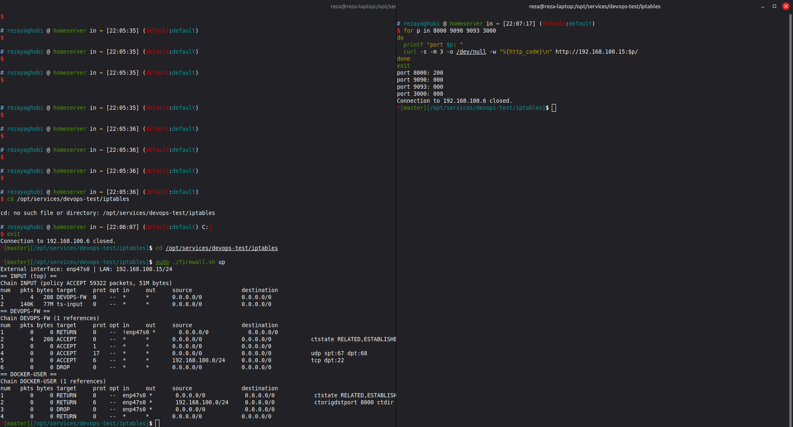
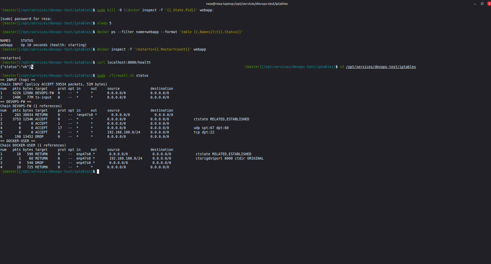
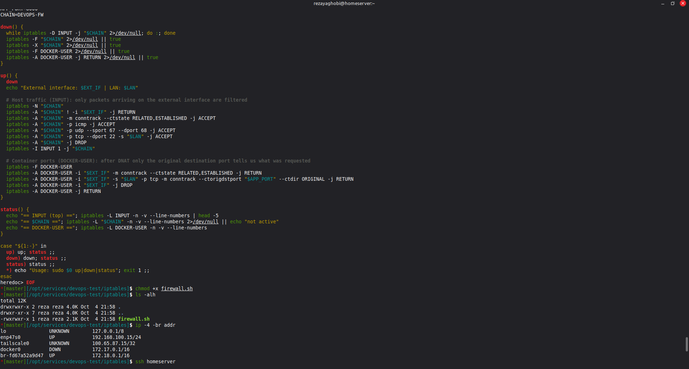

# Network security with iptables

[← Back to the main README](../README.md)

This document explains the firewall rules that restrict external access, why Docker needs special handling, how to apply and remove the rules, and the evidence that they work.

> **In plain words:** a firewall is a security guard at the door of the computer. The guard has a list of rules ("let replies in", "only people from the home network may open door 8000", "everyone else is turned away"). `iptables` is the tool that writes that list on Linux.

**Contents**

1. [Goal](#1-goal)
2. [Concepts you need](#2-concepts-you-need)
3. [The rules](#3-the-rules)
4. [Use the script](#4-use-the-script)
5. [Test plan and results](#5-test-plan-and-results)
6. [Evidence from the rule counters](#6-evidence-from-the-rule-counters)
7. [The script](#7-the-script)
8. [Limitations](#8-limitations)
9. [Troubleshooting](#9-troubleshooting)

---

## 1. Goal

The machine runs four services that publish ports: the webapp (8000), Prometheus (9090), Alertmanager (9093) and Grafana (3000). The requirement is to restrict external access:

| Port | Service | Who may connect |
|---|---|---|
| 8000 | Webapp | Computers on the local network |
| 9090 | Prometheus | Only this machine (localhost) |
| 9093 | Alertmanager | Only this machine |
| 3000 | Grafana | Only this machine |

Everything else arriving from the network is dropped, except normal replies to the machine's own connections.

## 2. Concepts you need

**Chains and rules.** iptables has *chains*, ordered lists of rules. A packet is compared with the rules from top to bottom, and the first matching rule decides: `ACCEPT` (let it through), `DROP` (silently discard) or `RETURN` (no decision here, go back to the calling chain).

**Connection tracking (`conntrack`).** Linux remembers connections. A packet that belongs to a conversation the machine started (`ESTABLISHED`) or is closely related to one (`RELATED`) can safely be allowed; this is how web pages you request can come back through a strict firewall.

**Why Docker needs special handling.** When a container publishes a port (`-p 9090:9090`), Docker rewrites the destination of incoming packets to the container's own address (this is called DNAT). Those packets are then *forwarded* to the container instead of being delivered to the host, so they never pass through the `INPUT` chain that most firewall guides use. The place Docker leaves for your own rules is the **`DOCKER-USER`** chain, which is checked before Docker's own rules.

```
 from the network
        |
   [ PREROUTING: Docker rewrites the destination (DNAT) ]
        |
        +--> addressed to the host itself ------> INPUT ........ chain DEVOPS-FW (this project)
        |
        +--> published container port ----------> FORWARD -> DOCKER-USER ... our container rules
```

Because the destination was rewritten, the rules use `--ctorigdstport`, which looks up the **original** port the client asked for.

## 3. The rules

Two sets of rules are created. Both only look at traffic arriving on the **external network interface** (for example `enp47s0`), so the machine's own traffic, Docker's internal networks and loopback are not affected.

### 3.1 Container ports: chain `DOCKER-USER`

| # | Rule | Meaning |
|---|---|---|
| 1 | `-i EXT_IF -m conntrack --ctstate RELATED,ESTABLISHED -j RETURN` | Replies to connections the machine opened are fine |
| 2 | `-i EXT_IF -s LAN -p tcp --ctorigdstport 8000 --ctdir ORIGINAL -j RETURN` | The local network may open port 8000 |
| 3 | `-i EXT_IF -j DROP` | Anything else arriving from outside towards a container is dropped (this blocks 9090, 9093 and 3000) |
| 4 | `-j RETURN` | Everything else (traffic between containers, outgoing traffic) continues to Docker's normal rules |

Connections from the machine itself (`localhost:9090`) do not arrive on the external interface, so they keep working.

### 3.2 The host itself: chain `DEVOPS-FW` (jumped to from `INPUT`)

| # | Rule | Meaning |
|---|---|---|
| 1 | `! -i EXT_IF -j RETURN` | Not our business if it did not arrive on the external interface (loopback, Docker bridges and VPN stay untouched) |
| 2 | `-m conntrack --ctstate RELATED,ESTABLISHED -j ACCEPT` | Replies are allowed |
| 3 | `-p icmp -j ACCEPT` | Ping and network diagnostics are allowed |
| 4 | `-p udp --sport 67 --dport 68 -j ACCEPT` | DHCP answers, so the machine can still get its network address |
| 5 | `-p tcp --dport 22 -s LAN -j ACCEPT` | SSH only from the local network |
| 6 | `-j DROP` | Everything else unsolicited is dropped |

A dedicated chain was used on purpose. Other software (here: Tailscale) adds its own rules to `INPUT`, and a separate chain can be added and removed without touching them.

## 4. Use the script

The script is `iptables/firewall.sh`. It needs root.

```bash
cd iptables
sudo ./firewall.sh up        # apply the rules and print them
sudo ./firewall.sh status    # show the rules with their packet counters
sudo ./firewall.sh down      # remove everything, back to the default state
```

By default the script detects the external interface from the default route and the local network from that interface's address. Override them if needed:

```bash
sudo EXT_IF=enp47s0 LAN=192.168.100.0/24 ./firewall.sh up
```

After `up` it prints, for example: `External interface: enp47s0 | LAN: 192.168.100.15/24`.

`down` is always safe to run: it removes the `DEVOPS-FW` chain and the jump to it, and resets `DOCKER-USER` to its default single `RETURN` rule.

## 5. Test plan and results

The test needs a **second machine** on the network, because connections from the machine to itself are never blocked. Here the home server (`192.168.100.6`) acted as the outside client, and the laptop (`192.168.100.15`) ran the services and the firewall.

The test, run on the second machine (it prints the HTTP status code, `000` means the connection timed out after 3 seconds):

```bash
for p in 8000 9090 9093 3000
do
  printf "port $p: "
  curl -s -m 3 -o /dev/null -w "%{http_code}\n" http://192.168.100.15:$p/
done
```

| Port | Service | Before the firewall | After `firewall.sh up` |
|---|---|---|---|
| 8000 | Webapp | `200` | `200` (allowed from the LAN) |
| 9090 | Prometheus | `302` (redirect to its UI) | `000` (blocked) |
| 9093 | Alertmanager | `200` | `000` (blocked) |
| 3000 | Grafana | `302` (redirect to the login page) | `000` (blocked) |



*Left: `sudo ./firewall.sh up` reports the external interface and the LAN and prints the rules. Right: the test from the server shows port 8000 answering `200` while 9090, 9093 and 3000 time out (`000`).*

The services remain fully usable on the machine itself:

```bash
curl -s localhost:9090/-/healthy      # Prometheus Server is Healthy.
curl -s localhost:3000/api/health     # Grafana answers {"database": "ok", ...}
```

## 6. Evidence from the rule counters

`iptables -L -v` shows how many packets each rule has handled. Counters that are above zero on the DROP rules prove that the rules are actually blocking traffic.



*The `status` output after the test:*

| Where | Rule | Packets | What it shows |
|---|---|---|---|
| `INPUT` | #1 jump to `DEVOPS-FW` | 4226 | `DEVOPS-FW` is checked first, before Tailscale's rules (`ts-input`) |
| `DEVOPS-FW` | #2 `RELATED,ESTABLISHED` | 3753 | Replies to the machine's own connections are allowed through |
| `DEVOPS-FW` | #6 `DROP` | 190 | Unsolicited inbound packets nobody allowed were dropped |
| `DOCKER-USER` | #2 LAN to port 8000 | 1 | The allowed connection to the webapp passed |
| `DOCKER-USER` | #3 `DROP` | 9 | The connection attempts to the blocked ports 9090, 9093 and 3000 (TCP retries the first packet) |

## 7. The script

<details>
<summary>Show <code>iptables/firewall.sh</code></summary>

```bash
#!/usr/bin/env bash
# Restrict external access to this host and to Docker-published ports.
# Usage: sudo ./firewall.sh up | down | status
set -euo pipefail

[ "$EUID" -eq 0 ] || { echo "Run with sudo"; exit 1; }

EXT_IF="${EXT_IF:-$(ip route show default | awk '/default/ {print $5; exit}')}"
[ -n "$EXT_IF" ] || { echo "No default route found, set EXT_IF=<interface>"; exit 1; }
LAN="${LAN:-$(ip -o -4 addr show dev "$EXT_IF" | awk '{print $4; exit}')}"
APP_PORT=8000
CHAIN=DEVOPS-FW

down() {
  while iptables -D INPUT -j "$CHAIN" 2>/dev/null; do :; done
  iptables -F "$CHAIN" 2>/dev/null || true
  iptables -X "$CHAIN" 2>/dev/null || true
  iptables -F DOCKER-USER 2>/dev/null || true
  iptables -A DOCKER-USER -j RETURN 2>/dev/null || true
}

up() {
  down
  echo "External interface: $EXT_IF | LAN: $LAN"

  # Host traffic (INPUT): only packets arriving on the external interface are filtered
  iptables -N "$CHAIN"
  iptables -A "$CHAIN" ! -i "$EXT_IF" -j RETURN
  iptables -A "$CHAIN" -m conntrack --ctstate RELATED,ESTABLISHED -j ACCEPT
  iptables -A "$CHAIN" -p icmp -j ACCEPT
  iptables -A "$CHAIN" -p udp --sport 67 --dport 68 -j ACCEPT
  iptables -A "$CHAIN" -p tcp --dport 22 -s "$LAN" -j ACCEPT
  iptables -A "$CHAIN" -j DROP
  iptables -I INPUT 1 -j "$CHAIN"

  # Container ports (DOCKER-USER): after DNAT only the original destination port tells us what was requested
  iptables -F DOCKER-USER
  iptables -A DOCKER-USER -i "$EXT_IF" -m conntrack --ctstate RELATED,ESTABLISHED -j RETURN
  iptables -A DOCKER-USER -i "$EXT_IF" -s "$LAN" -p tcp -m conntrack --ctorigdstport "$APP_PORT" --ctdir ORIGINAL -j RETURN
  iptables -A DOCKER-USER -i "$EXT_IF" -j DROP
  iptables -A DOCKER-USER -j RETURN
}

status() {
  echo "== INPUT (top) =="; iptables -L INPUT -n -v --line-numbers | head -5
  echo "== $CHAIN =="; iptables -L "$CHAIN" -n -v --line-numbers 2>/dev/null || echo "not active"
  echo "== DOCKER-USER =="; iptables -L DOCKER-USER -n -v --line-numbers
}

case "${1:-}" in
  up) up; status ;;
  down) down; status ;;
  status) status ;;
  *) echo "Usage: sudo $0 up|down|status"; exit 1 ;;
esac
```

</details>



*The terminal shows the script as saved on the laptop, and `ip -4 -br addr`, which lists the interfaces: `enp47s0` (the wired network, `192.168.100.15/24`), `tailscale0` (VPN), and the Docker bridges.*

## 8. Limitations

| Limitation | Detail |
|---|---|
| **Not persistent** | The rules disappear after a reboot (and `down` removes them on purpose). To keep them, run the script at boot (for example from a systemd unit) or use `iptables-persistent` or nftables |
| **IPv4 only** | Docker also publishes ports on IPv6 (`[::]:8000`). A production setup needs the same rules in `ip6tables`, or IPv6 disabled on the host |
| **One external interface** | Only the interface detected as `EXT_IF` is filtered. Traffic arriving through another interface, such as a VPN (`tailscale0`) or a second network card, is not touched by these rules |
| **Port 8000 is fixed** | Change `APP_PORT` in the script if the webapp port changes |
| **`DOCKER-USER` is replaced** | `up` empties the chain before adding its rules, so any other custom rule in it would be lost |
| **Not a complete host firewall** | Other services listening directly on the host (not in containers) are only covered by the `DEVOPS-FW` rules |

## 9. Troubleshooting

| Symptom | Cause and fix |
|---|---|
| The second machine cannot reach even port 8000, and `ping` fails, **before** the firewall | A VPN is routing the replies another way. This happened with Tailscale: the laptop accepted the home network as a "subnet route" and answered through the tunnel instead of the cable. `ip route get <other-machine-ip>` shows the interface used. Fix for the test: `sudo tailscale set --accept-routes=false` (turn it back on afterwards with `=true`) |
| Locked out or something broke | `sudo ./firewall.sh down` removes everything immediately |
| `iptables: No chain/target/match by that name` for `DOCKER-USER` | Docker is not running. Start Docker first |
| Rules seem ignored | Another firewall manager may be active: `sudo ufw status` should say `inactive` |
| `Run with sudo` | The script needs root to change firewall rules |
| Wrong interface detected | Pass it explicitly: `sudo EXT_IF=<name> ./firewall.sh up` (list names with `ip -br addr`) |
