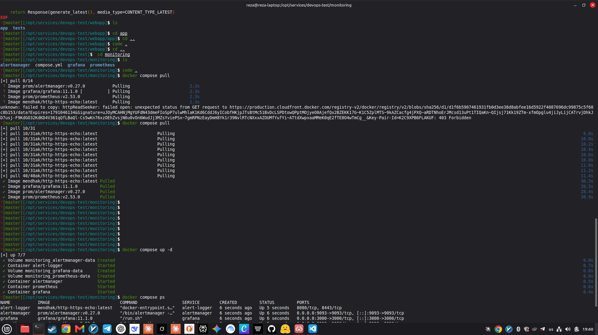
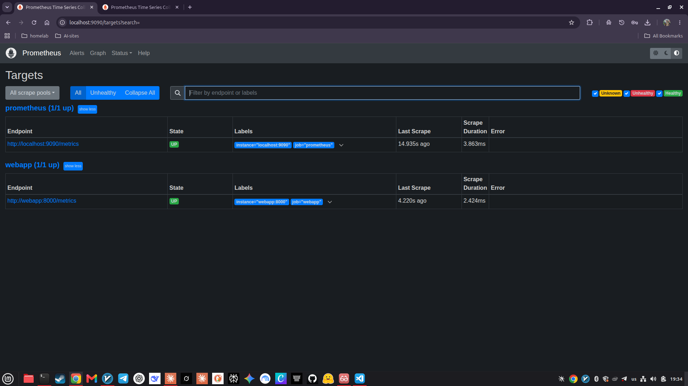
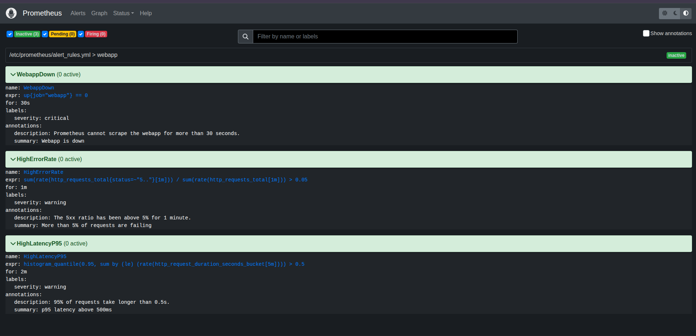
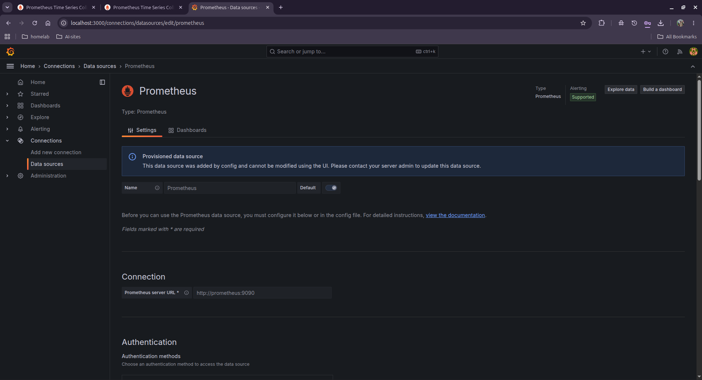
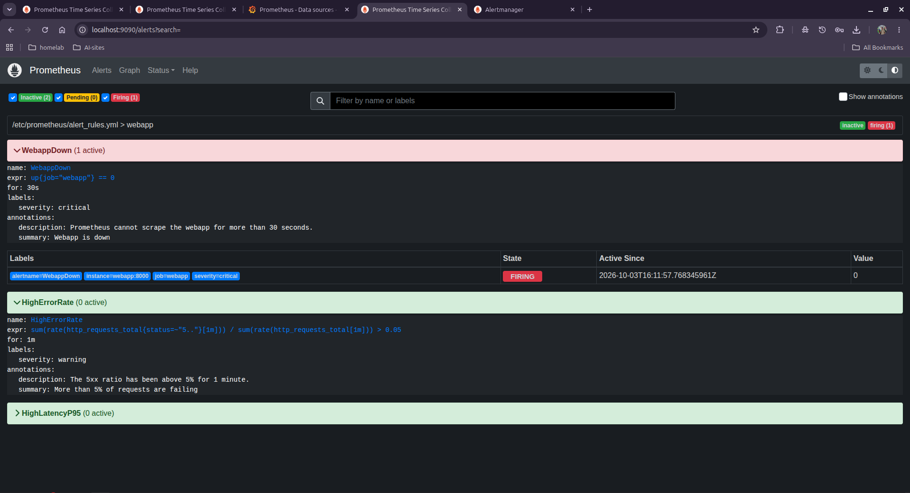
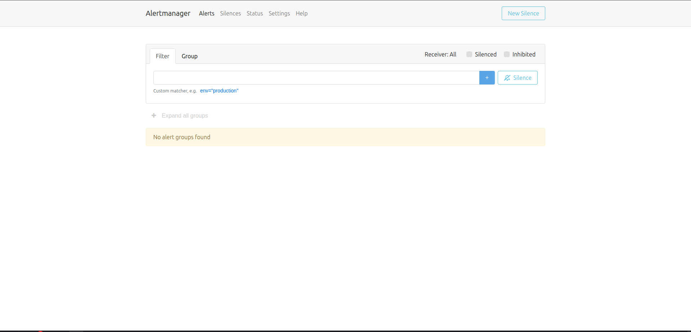
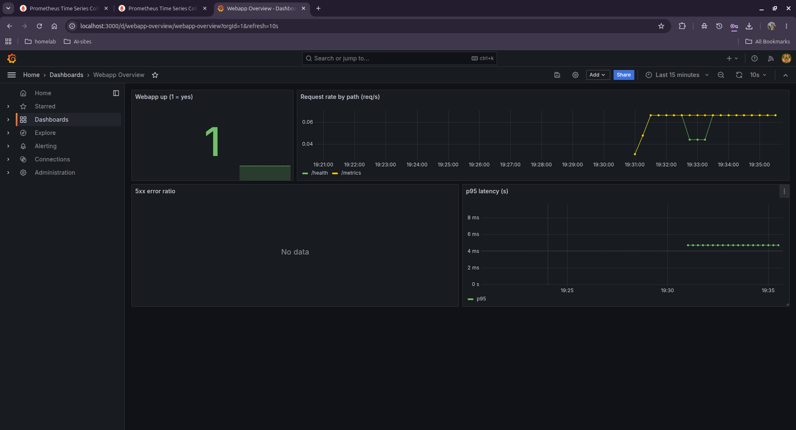

# Monitoring and alerting

[← Back to the main README](../README.md)

This document explains how the web service is monitored: how numbers are collected (Prometheus), how problems are detected (alert rules), how people are told (Alertmanager), and how the data is shown (Grafana).

> **In plain words:** Prometheus is a collector that visits the web service every 15 seconds and writes down its numbers. Alert rules are questions Prometheus asks over and over ("is the service down?"). When the answer is yes for long enough, Alertmanager sends a message. Grafana draws the numbers as charts.

**Contents**

1. [Architecture](#1-architecture)
2. [Files in `monitoring/`](#2-files-in-monitoring)
3. [How each part is configured](#3-how-each-part-is-configured)
4. [Start the stack](#4-start-the-stack)
5. [Verify it works](#5-verify-it-works)
6. [Trigger and read an alert](#6-trigger-and-read-an-alert)
7. [Grafana](#7-grafana)
8. [Troubleshooting](#8-troubleshooting)
9. [What would change in production](#9-what-would-change-in-production)

---

## 1. Architecture

```
                scrapes /metrics every 15 s
 +-----------+ <------------------------------- +------------+
 |  webapp   |                                  | Prometheus |  evaluates the alert rules
 |   :8000   |                                  |   :9090    |  every 15 s
 +-----------+                                  +-----+------+
                                                      | sends alerts that are firing
                                                      v
                                              +---------------+  webhook   +--------------+
                                              | Alertmanager  | ---------> | alert-logger |
                                              |    :9093      |            | prints them  |
                                              +---------------+            +--------------+

 +-----------+   asks Prometheus questions (PromQL)
 |  Grafana  | ----------------------------------> Prometheus
 |   :3000   |
 +-----------+
```

All containers share the Docker network `monitoring-net`, so they find each other by name (`webapp:8000`, `prometheus:9090`, `alertmanager:9093`). Only the ports in the diagram are published on the host.

| Component | Image | Role |
|---|---|---|
| Prometheus | `prom/prometheus:v2.53.0` | Collects and stores metrics, evaluates alert rules |
| Alertmanager | `prom/alertmanager:v0.27.0` | Groups alerts and delivers them to a receiver |
| alert-logger | `mendhak/http-https-echo` | A tiny receiver that prints every notification it gets. It stands in for e-mail or Slack, so the project needs no external account |
| Grafana | `grafana/grafana:11.1.0` | Dashboards |

## 2. Files in `monitoring/`

```
monitoring/
├── compose.yml                              starts the four containers
├── prometheus/
│   ├── prometheus.yml                       what to scrape, where to send alerts
│   └── alert_rules.yml                      the alert rules
├── alertmanager/
│   └── alertmanager.yml                     how alerts are routed
└── grafana/
    ├── provisioning/
    │   ├── datasources/prometheus.yml       connects Grafana to Prometheus automatically
    │   └── dashboards/dashboards.yml        tells Grafana to load dashboards from a folder
    └── dashboards/
        └── webapp.json                      the "Webapp Overview" dashboard
```

Everything is configured by files, so the whole setup can be recreated from the repository without clicking in any web interface.

## 3. How each part is configured

### 3.1 `compose.yml`

Four services (`prometheus`, `alertmanager`, `alert-logger`, `grafana`), all with `restart: unless-stopped`, all on the external network `monitoring-net`. Configuration files are mounted read-only into the containers (`:ro`). Three named volumes (`prometheus-data`, `alertmanager-data`, `grafana-data`) keep the data when containers are recreated. Prometheus keeps 7 days of history (`--storage.tsdb.retention.time=7d`) and has `--web.enable-lifecycle` on, which allows reloading its configuration without a restart.

### 3.2 `prometheus/prometheus.yml`

```yaml
global:
  scrape_interval: 15s
  evaluation_interval: 15s

alerting:
  alertmanagers:
    - static_configs:
        - targets: ["alertmanager:9093"]

rule_files:
  - /etc/prometheus/alert_rules.yml

scrape_configs:
  - job_name: prometheus
    static_configs:
      - targets: ["localhost:9090"]

  - job_name: webapp
    metrics_path: /metrics
    static_configs:
      - targets: ["webapp:8000"]
```

- **scrape_interval**: how often targets are visited. **evaluation_interval**: how often alert rules are checked.
- **alerting**: where firing alerts are sent.
- **scrape_configs**: two targets. Prometheus monitors itself, and the `webapp` job reads `http://webapp:8000/metrics`.

### 3.3 `prometheus/alert_rules.yml`

```yaml
groups:
  - name: webapp
    rules:
      - alert: WebappDown
        expr: up{job="webapp"} == 0
        for: 30s
        labels:
          severity: critical
        annotations:
          summary: "Webapp is down"
          description: "Prometheus cannot scrape the webapp for more than 30 seconds."

      - alert: HighErrorRate
        expr: sum(rate(http_requests_total{status=~"5.."}[1m])) / sum(rate(http_requests_total[1m])) > 0.05
        for: 1m
        labels:
          severity: warning
        annotations:
          summary: "More than 5% of requests are failing"
          description: "The 5xx ratio has been above 5% for 1 minute."

      - alert: HighLatencyP95
        expr: histogram_quantile(0.95, sum by (le) (rate(http_request_duration_seconds_bucket[5m]))) > 0.5
        for: 2m
        labels:
          severity: warning
        annotations:
          summary: "p95 latency above 500ms"
          description: "95% of requests take longer than 0.5s."
```

What the three rules ask, in plain words:

| Alert | The question | Fires after |
|---|---|---|
| `WebappDown` | `up` is 1 when Prometheus could read the target and 0 when it could not. "Is the webapp unreachable?" | 30 s |
| `HighErrorRate` | `rate(...[1m])` is "per second, averaged over the last minute". Errors per second divided by all requests per second is the share of failures. "Are more than 5% failing?" | 1 min |
| `HighLatencyP95` | `histogram_quantile(0.95, ...)` is the time that 95 out of 100 requests beat. "Are the slowest 5% taking longer than half a second?" | 2 min |

The `for:` delay prevents false alarms from a single bad reading. An alert goes through three states: **inactive** (all fine), **pending** (condition true, waiting out the `for:` time) and **firing** (alert sent).

The rules alert on what users feel (down, failing, slow), not on internal causes such as CPU usage.

### 3.4 `alertmanager/alertmanager.yml`

```yaml
route:
  receiver: logger
  group_by: ["alertname"]
  group_wait: 10s
  group_interval: 1m
  repeat_interval: 1h

receivers:
  - name: logger
    webhook_configs:
      - url: http://alert-logger:8080/
        send_resolved: true
```

- **group_by**: alerts with the same name are bundled into one message.
- **group_wait: 10s**: after the first alert arrives, wait 10 s to bundle related alerts before sending.
- **group_interval: 1m**: minimum time between messages about changes in the same group.
- **repeat_interval: 1h**: re-send a still-firing alert every hour.
- **send_resolved: true**: also notify when the problem is over.

### 3.5 Grafana provisioning

- `datasources/prometheus.yml` registers Prometheus (`http://prometheus:9090`) as the default data source.
- `dashboards/dashboards.yml` tells Grafana to load every dashboard file in `/var/lib/grafana/dashboards`.
- `dashboards/webapp.json` is the **Webapp Overview** dashboard with four panels: webapp up (1 = yes), request rate by path, 5xx error ratio, and p95 latency.

## 4. Start the stack

The webapp stack must exist first, because both stacks use the same network:

```bash
docker network create monitoring-net     # only once
cd webapp && docker compose up -d --build
cd ../monitoring && docker compose up -d
docker compose ps
```



*The first `docker compose pull` hit a temporary "403 Forbidden" while downloading one layer from Docker Hub's content network; running it again succeeded. Then `docker compose up -d` creates the three volumes and starts all four containers.*

Check the configuration for mistakes before or after starting:

```bash
docker exec prometheus promtool check config /etc/prometheus/prometheus.yml
```

## 5. Verify it works

| What | Where |
|---|---|
| Prometheus targets | http://localhost:9090/targets |
| Alert rules | http://localhost:9090/alerts |
| Alertmanager | http://localhost:9093 |
| Grafana | http://localhost:3000 (user `admin`, password `admin` unless `GRAFANA_PASSWORD` is set) |

**Targets.** Both `prometheus` and `webapp` must be **UP**.



*`webapp` is scraped at `http://webapp:8000/metrics` (the container name resolves over the shared network). The scrape takes about 2 ms.*

**Alert rules.** All three rules are loaded and inactive while everything is healthy.



*The page shows each rule's expression, its `for` time, labels and annotations, which match `alert_rules.yml`.*

**Grafana data source.** It was created by configuration, not by hand.



*Grafana says "This data source was added by config and cannot be modified using the UI", which proves provisioning works. The URL is `http://prometheus:9090`.*

## 6. Trigger and read an alert

### Test 1: the webapp goes down

`docker stop` is a deliberate stop, so the restart policy does not bring the container back, and the target stays down:

```bash
docker stop webapp
```

Watch http://localhost:9090/alerts. After the `for: 30s` delay, `WebappDown` turns red:



*`WebappDown` is FIRING with the labels `instance=webapp:8000`, `job=webapp`, `severity=critical`. The other two rules stay inactive. "Active Since" shows the moment Prometheus first saw the target down.*

Alertmanager then delivers the notification to the receiver. Read it with:

```bash
docker logs alert-logger --tail 40
```

The log of the test run contained (shortened):

```
"status": "firing",
"labels": { "alertname": "WebappDown", "instance": "webapp:8000", "job": "webapp", "severity": "critical" },
"annotations": { "summary": "Webapp is down", "description": "Prometheus cannot scrape the webapp for more than 30 seconds." },
"startsAt": "2026-10-03T16:12:27.768Z",
...
::ffff:172.18.0.4 - - [03/Oct/2026:16:12:37 +0000] "POST / HTTP/1.1" 200 2729 "-" "Alertmanager/0.27.0"
```

**The timeline matches the configuration:**

| Time (UTC) | Event |
|---|---|
| 16:11:57 | Prometheus sees the webapp down; the alert is *pending* ("Active Since" in the screenshot) |
| 16:12:27 | 30 s later (`for: 30s`) the alert starts *firing* (`startsAt`) |
| 16:12:37 | 10 s later (`group_wait: 10s`) Alertmanager delivers it, and the receiver answers `200` |

Bring the service back; a "resolved" notification follows because of `send_resolved: true`:

```bash
docker start webapp
```

**Alertmanager's own page** at http://localhost:9093 lists alerts that are active right now:



*This capture was taken when nothing was firing, which is why it says "No alert groups found". During an incident the firing alert appears here, grouped by `alertname`.*

### Test 2: many requests fail

```bash
for i in $(seq 1 600); do curl -s localhost:8000/error > /dev/null; sleep 0.2; done
```

`/error` returns 500 every time, so the share of failed requests rises above 5%. After one minute `HighErrorRate` starts firing. The Grafana panel **5xx error ratio** shows the spike.

## 7. Grafana

Open http://localhost:3000, sign in, then go to **Dashboards → Webapp Overview**. It refreshes every 10 seconds.



*Top left: the webapp is up (1). Top right: requests per second, split by path. The two lines are `/health` (Docker's health check) and `/metrics` (Prometheus's own scrapes). Bottom right: the p95 latency is around 5 ms. Bottom left: "No data" is correct, because no 5xx errors had happened yet; the panel fills in once `/error` is called.*

> The default password `admin` is acceptable on a laptop only. Set a real one with the environment variable `GRAFANA_PASSWORD` before exposing Grafana anywhere.

## 8. Troubleshooting

| Symptom | What to check |
|---|---|
| `docker compose pull` fails with `403 Forbidden` | The download network refused one layer. Run the command again; if it keeps failing, pull the images on another connection or use a registry mirror |
| Target `webapp` is DOWN | Is the webapp container running (`docker ps`)? Is it on the shared network (`docker network inspect monitoring-net`)? Does `curl localhost:8000/metrics` work? |
| Alerts page is empty | The rules file did not load. Run `promtool check config` (above) and read `docker logs prometheus` |
| Changed a rule or config | Reload without restarting: `curl -X POST localhost:9090/-/reload` |
| Alert fires but nothing arrives | Is Alertmanager reachable (`docker logs alertmanager`)? Is `alert-logger` running? Check http://localhost:9090/status for the alertmanager list |
| Grafana panels show "No data" | Wait a minute for data; check the time range (top right); confirm the data source is healthy on the data sources page |

## 9. What would change in production

- Real receivers (e-mail, Slack, PagerDuty) instead of the logging webhook, with secrets kept out of the repository.
- Authentication and TLS in front of Prometheus, Alertmanager and Grafana (they are open on their ports here).
- A strong Grafana password and pinned image versions everywhere (`alert-logger` uses the `latest` tag in this project).
- A longer retention or remote storage, and Alertmanager high availability.
- Alerts that also cover the host (disk, memory) and the Docker daemon, for example with `node_exporter` and `cAdvisor`.
