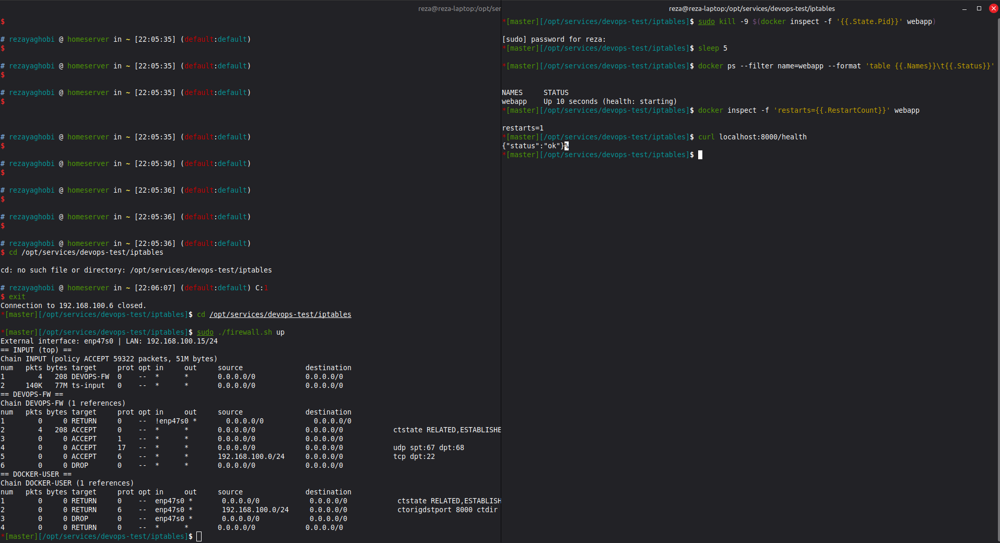
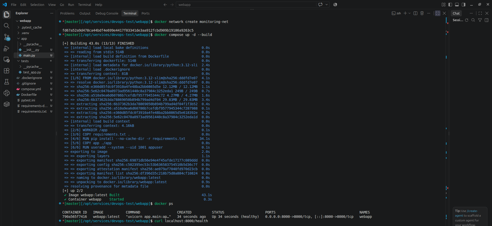

# The web application and its container

[← Back to the main README](../README.md)

This document explains the small Python web service that the rest of the project deploys, builds, monitors and protects: what it does, how it is tested, and how the Dockerfile and Compose file turn it into a container.

> **In plain words:** the webapp is a tiny web server with a health page and a page that counts things, so the monitoring can watch it. Docker packs it into a box (a *container*) together with everything it needs to run, so the same box runs the same way on any machine.

**Contents**

1. [What the service does](#1-what-the-service-does)
2. [The application code](#2-the-application-code)
3. [The tests](#3-the-tests)
4. [The Dockerfile, line by line](#4-the-dockerfile-line-by-line)
5. [The Compose file](#5-the-compose-file)
6. [The health check](#6-the-health-check)
7. [Restart policy and crash recovery](#7-restart-policy-and-crash-recovery)
8. [Run and verify](#8-run-and-verify)
9. [Troubleshooting](#9-troubleshooting)
10. [What would change in production](#10-what-would-change-in-production)

---

## 1. What the service does

The service is a **FastAPI** application served by **uvicorn** on port **8000**. It is deliberately small, but it exposes everything the other parts of the test need: a health endpoint for Docker, a metrics endpoint for Prometheus, and an endpoint that always fails so the error-rate alert can be triggered on purpose.

| Method | Path | Response | Why it exists |
|---|---|---|---|
| `GET` | `/` | `{"message": "Hello from the DevOps test service"}` | Proves the service is reachable |
| `GET` | `/health` | `{"status": "ok"}` | Read by Docker's health check |
| `GET` | `/error` | HTTP `500` | Generates 5xx responses to trigger the `HighErrorRate` alert |
| `GET` | `/metrics` | Prometheus text format | Scraped by Prometheus every 15 s |

Every request is also measured. Two metrics are exported:

| Metric | Type | Labels | Meaning |
|---|---|---|---|
| `http_requests_total` | Counter | `method`, `path`, `status` | How many requests, split by outcome |
| `http_request_duration_seconds` | Histogram | `path` | How long requests take, as a distribution |

The histogram is what lets Prometheus answer "are the slowest 5% of requests taking too long?" in `docs/monitoring.md`.

The files that make up the service:

```
webapp/
├── app/
│   └── main.py              the whole application
├── tests/
│   └── test_app.py          four pytest tests
├── requirements.txt         runtime dependencies
├── requirements-dev.txt     test dependencies
├── pytest.ini               lets pytest import the app
├── Dockerfile               builds the image
├── compose.yml              runs the container
└── .dockerignore            keeps junk out of the image
```

## 2. The application code

The entire application is `webapp/app/main.py`:

```python
import time

from fastapi import FastAPI, HTTPException, Request, Response
from prometheus_client import CONTENT_TYPE_LATEST, Counter, Histogram, generate_latest

app = FastAPI(title="DevOps Test Service")

REQUESTS = Counter(
    "http_requests_total", "Total HTTP requests", ["method", "path", "status"]
)
LATENCY = Histogram(
    "http_request_duration_seconds", "Request latency in seconds", ["path"]
)


@app.middleware("http")
async def track_metrics(request: Request, call_next):
    start = time.perf_counter()
    response = await call_next(request)
    path = request.url.path
    REQUESTS.labels(request.method, path, response.status_code).inc()
    LATENCY.labels(path).observe(time.perf_counter() - start)
    return response


@app.get("/")
def index():
    return {"message": "Hello from the DevOps test service"}


@app.get("/health")
def health():
    return {"status": "ok"}


@app.get("/error")
def error():
    # Used to generate 5xx responses and trigger the high-error-rate alert
    raise HTTPException(status_code=500, detail="simulated failure")


@app.get("/metrics")
def metrics():
    return Response(generate_latest(), media_type=CONTENT_TYPE_LATEST)
```

- The two metric objects are created **once**, at import time. Prometheus's client keeps a global registry, so they exist as soon as the process starts.
- The **middleware** wraps every request: it records the start time, lets the request run, then increments the counter with the method, the path and the real status code, and records the duration in the histogram. This is why the response code of `/error` (`500`) shows up in the metrics even though the handler raises an exception.
- `/error` raises `HTTPException(500)`. FastAPI turns that into a proper `500` JSON response, so it is a controlled failure, not a crash.
- `/metrics` returns the generated exposition text with the right content type, so Prometheus can read it directly.

## 3. The tests

There are four tests in `webapp/tests/test_app.py`, using FastAPI's `TestClient`:

```python
from fastapi.testclient import TestClient

from app.main import app

client = TestClient(app)


def test_index():
    r = client.get("/")
    assert r.status_code == 200


def test_health():
    r = client.get("/health")
    assert r.status_code == 200
    assert r.json() == {"status": "ok"}


def test_error_endpoint_returns_500():
    assert client.get("/error").status_code == 500


def test_metrics_exposed():
    client.get("/health")
    r = client.get("/metrics")
    assert r.status_code == 200
    assert "http_requests_total" in r.text
```

| Test | What it proves |
|---|---|
| `test_index` | The app starts and serves a request |
| `test_health` | The health endpoint returns exactly `{"status": "ok"}` — the contract Docker's health check relies on |
| `test_error_endpoint_returns_500` | `/error` really fails with `500`, so the alert can be triggered |
| `test_metrics_exposed` | Metrics are generated and contain the request counter |

`pytest.ini` contains `pythonpath = .`, which is what lets the tests `from app.main import app` without installing the package. The test-only dependencies (`pytest`, `httpx`) are in `requirements-dev.txt`, kept separate from the runtime `requirements.txt` so the production image stays small.

Run them locally with:

```bash
cd webapp
pip install -r requirements-dev.txt
pytest -v
```

The CI pipeline runs exactly this (see `docs/gitlab.md`), and GitLab shows the four tests in the pipeline's **Tests** tab.

## 4. The Dockerfile, line by line

```dockerfile
FROM python:3.12-slim

ENV PYTHONDONTWRITEBYTECODE=1 PYTHONUNBUFFERED=1
WORKDIR /app

COPY requirements.txt .
RUN pip install --no-cache-dir -r requirements.txt

COPY app ./app

RUN useradd --system --uid 1001 appuser
USER appuser

EXPOSE 8000
HEALTHCHECK --interval=15s --timeout=3s --retries=3 \
  CMD python -c "import urllib.request; urllib.request.urlopen('http://localhost:8000/health')" || exit 1

CMD ["uvicorn", "app.main:app", "--host", "0.0.0.0", "--port", "8000"]
```

| Line | What it does and why |
|---|---|
| `FROM python:3.12-slim` | Starts from a small official Python image. `slim` omits compilers and docs the service does not need |
| `ENV PYTHONDONTWRITEBYTECODE=1 PYTHONUNBUFFERED=1` | No `.pyc` files inside the container, and logs appear immediately instead of being buffered (important for `docker logs`) |
| `WORKDIR /app` | All following commands run in `/app` |
| `COPY requirements.txt .` then `RUN pip install` | Dependencies are copied **before** the app code. Docker caches this layer, so changing a source file does not reinstall packages |
| `--no-cache-dir` | Does not keep pip's download cache in the image, saving space |
| `COPY app ./app` | Copies only the application code |
| `RUN useradd …` + `USER appuser` | The container runs as a non-root user (uid 1001). If the app is ever compromised, it does not run as root |
| `EXPOSE 8000` | Documents the port. Publishing it is done by Compose, not here |
| `HEALTHCHECK …` | Every 15 s Docker calls `/health`; after 3 failures in a row the container is marked `unhealthy` (see [section 6](#6-the-health-check)) |
| `CMD ["uvicorn", …]` | The exec form (`["…"]`) makes uvicorn PID 1, so it receives stop signals directly |

`.dockerignore` excludes `.venv/`, `__pycache__/`, `*.pyc` and `.pytest_cache/`, so those never end up in the image.

## 5. The Compose file

```yaml
services:
  webapp:
    build: .
    image: webapp:latest
    container_name: webapp
    restart: unless-stopped
    ports:
      - "8000:8000"
    networks:
      - monitoring-net

networks:
  monitoring-net:
    external: true
```

| Setting | Meaning |
|---|---|
| `build: .` | Build the image from the Dockerfile in this folder |
| `image: webapp:latest` | Name the built image, so `deploy` can start it with `--no-build` |
| `container_name: webapp` | A fixed name, which the pipeline's health check and the docs refer to |
| `restart: unless-stopped` | Restart automatically after a crash (see [section 7](#7-restart-policy-and-crash-recovery)) |
| `ports: 8000:8000` | Publish the port to the host, so the service is reachable and Prometheus/curl can reach it |
| `networks: monitoring-net` | Join the shared network, so Prometheus and Grafana find `webapp` by name |

`monitoring-net` is declared `external: true`: Compose expects the network to already exist instead of creating it. That is why the setup and the deploy stage run `docker network create monitoring-net` first (see `docs/monitoring.md` and `docs/gitlab.md`). Marking it external is what lets the webapp stack and the monitoring stack share one network even though they are separate Compose projects.

## 6. The health check

The health check has two halves that meet at `/health`:

- **The endpoint** — `app/main.py` returns `{"status": "ok"}` only when the app itself is running and serving requests.
- **The check** — the Dockerfile's `HEALTHCHECK` runs `python -c "…urlopen('http://localhost:8000/health')"` every 15 s, with a 3 s timeout and 3 retries.

Docker tracks the result and gives the container a state:

| State | When |
|---|---|
| `starting` | Right after start, before the first successful check |
| `healthy` | The check returns success |
| `unhealthy` | Three consecutive failures |

This state is not decoration. The CI **deploy** stage reads it with `docker inspect -f '{{.State.Health.Status}}' webapp` and fails the job if it never becomes `healthy` (see `docs/gitlab.md`). So the health check is what turns "the container started" into "the service works".

Check it by hand:

```bash
docker inspect -f '{{.State.Health.Status}}' webapp
docker inspect -f '{{json .State.Health}}' webapp | python3 -m json.tool
```

## 7. Restart policy and crash recovery

The Compose file sets `restart: unless-stopped`. Docker has several policies:

| Policy | Restarts after a crash | Restarts after `docker stop` | After a host reboot |
|---|---|---|---|
| `no` (default) | no | no | no |
| `on-failure` | yes (only non-zero exits) | no | no |
| `always` | yes | yes — even something you stopped by hand | yes |
| `unless-stopped` | yes | no | yes (unless you had stopped it) |

`unless-stopped` is the right middle ground: a crash is recovered automatically, but a container you stopped **on purpose** stays stopped. That distinction matters for the monitoring test in `docs/monitoring.md`, where `docker stop webapp` is used to trigger the `WebappDown` alert and must *not* be undone by the restart policy.

**The crash-recovery demonstration.** `docker kill` is not a graceful stop: it sends `SIGKILL`, the container dies immediately with a non-zero exit code, and the policy brings it back.

```bash
# 1. Note the current container and its restart count
docker ps --format '{{.Names}}\t{{.Status}}' | grep webapp
docker inspect -f '{{.RestartCount}}' webapp

# 2. Kill it hard
docker kill webapp

# 3. A moment later it is back — same container name, RestartCount increased
docker ps --format '{{.Names}}\t{{.Status}}' | grep webapp
docker inspect -f '{{.RestartCount}}' webapp
```



*After `docker kill webapp` the container disappears for a moment and Docker starts it again on its own: `docker ps` shows `webapp` up again with a higher `RestartCount`, and no command was typed to bring it back.*

Two things this deliberately does **not** cover:

- A container stopped with `docker stop` is considered a deliberate stop and stays down. That is the documented behavior, used on purpose in the monitoring test.
- `restart: unless-stopped` restarts the **container**, not the whole stack. If the Docker daemon itself is restarted, the policy is re-applied at daemon startup — but the network `monitoring-net` must still exist.

## 8. Run and verify

The webapp stack must be started before the monitoring stack, because both use the same network:

```bash
docker network create monitoring-net     # only once
cd webapp
docker compose up -d --build
```



*`docker compose up -d --build` builds the image, creates the container and starts it detached. `docker ps` then shows `webapp` up, on port `8000`, with its health status.*

Confirm it works from the outside:

```bash
docker ps                                        # webapp is Up
curl localhost:8000/health                       # {"status":"ok"}
curl localhost:8000/                              # {"message":"Hello from the DevOps test service"}
curl -s localhost:8000/metrics | head -3          # Prometheus exposition text
curl -s -o /dev/null -w "%{http_code}\n" localhost:8000/error   # 500, on purpose
```

Watch the health state turn `healthy`:

```bash
docker inspect -f '{{.State.Health.Status}}' webapp
```

Stop the stack (this keeps the data volumes and the image):

```bash
docker compose down
```

## 9. Troubleshooting

| Symptom | Cause and fix |
|---|---|
| `docker compose up` fails with `network monitoring-net … not found` | The network is declared external. Create it once: `docker network create monitoring-net` |
| Port `8000` is already in use | Another process or an old container holds it. Find it with `ss -ltnp \| grep 8000` or `docker ps`, then stop it |
| The container is `unhealthy` | The app is not answering `/health`. Read `docker logs webapp`; test locally with `cd webapp && pytest -v` |
| `docker compose up` reuses an old image | The build was skipped or cached. Rebuild with `docker compose up -d --build` |
| A `docker stop webapp` did **not** restart it | Expected: `unless-stopped` treats a deliberate stop as final. Use `docker start webapp` (or `docker compose up -d`) |
| `docker kill webapp` did not restart it | Check the policy with `docker inspect -f '{{.HostConfig.RestartPolicy.Name}}' webapp`; it must be `unless-stopped` |
| Changes to `main.py` do not appear | The running container still uses the old image. Rebuild: `docker compose up -d --build` |
| `pytest` cannot import `app` | Run it from `webapp/` so `pytest.ini` (`pythonpath = .`) applies |

## 10. What would change in production

- **Pin the base image and dependencies.** `python:3.12-slim` floats; in production pin a digest and pin the versions in `requirements.txt` for reproducible builds.
- **Read-only filesystem and dropped capabilities.** The app needs no write access and no privileges; add `read_only: true` and `cap_drop: ["ALL"]` to harden the container.
- **Run uvicorn with multiple workers.** A single process is fine for a demonstration, but production would use `--workers` (or Gunicorn with uvicorn workers) and CPU/memory limits.
- **TLS and authentication in front of the service.** Here it is served in plain HTTP; a real deployment terminates TLS at a reverse proxy.
- **A real health/readiness split.** Docker's `HEALTHCHECK` doubles as liveness and readiness; production often separates `/healthz` and `/readyz`.
- **Image scanning and a registry.** The image is built locally and deployed by tag; production would push to a registry and scan for vulnerabilities (see the `publish` stage in `docs/gitlab.md`).
